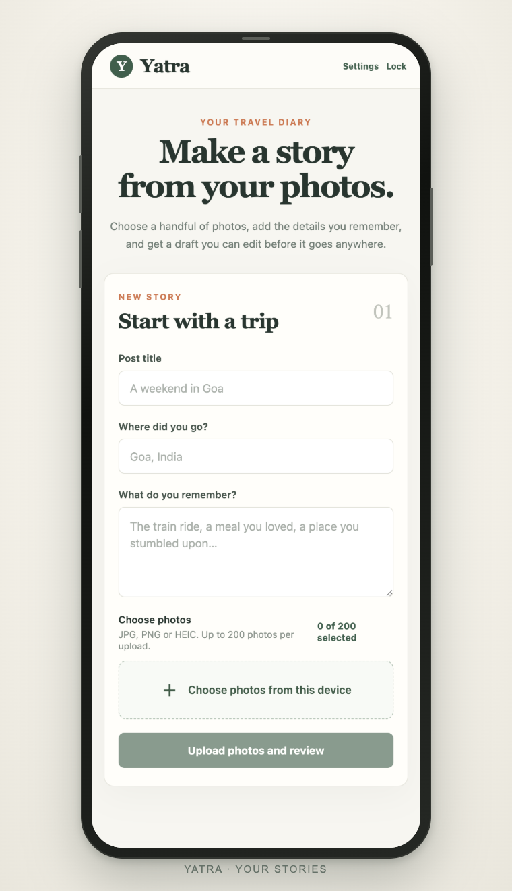
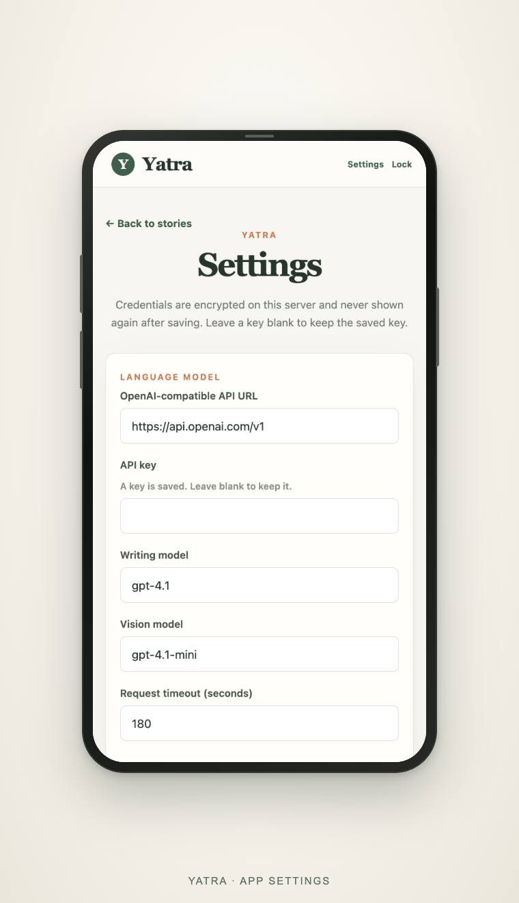

# Yatra

Yatra turns travel photos and notes into a beautiful travel post. It is integrated with the Ghost blogging platform, and can be used from a desktop or a phone on your local network and a locally hosted LLM.

The app uses a Go backend, SQLite, a React frontend, Ghost's Koenig editor, and an OpenAI-compatible API for photo descriptions and writing. Photos are supported; video is not currently supported.

<table>
  <tr>
    <td align="center"><br><sub>Start a story from photos, a location, and notes</sub></td>
    <td align="center"><br><sub>Configure models and Ghost from the phone-friendly settings screen</sub></td>
  </tr>
</table>

These featured screenshots use sample settings and contain no real credentials. Regenerate them with the local frontend running on port 5173 and Google Chrome installed by running `node frontend/scripts/capture-readme-screenshots.mjs`.

## Current workflow

1. **Upload photos** from your computer or phone. The default limit is 200 photos per upload and is configurable.
2. **Review photos** with thumbnails and automatically generated descriptions. Browse all photos or recommendations, select individual images or select all, and choose a header photo with the star button.
3. **Generate a draft** using your location, notes, and photo descriptions. Photos are placed within story sections, using full-width lead images, pairs, and four-photo groups.
4. **Edit in the browser** using Ghost's Koenig editor. Change the title, text, headings, captions, and images; edits save automatically. Resume saved drafts from either device.
5. **Send draft to Ghost** when ready. Export uploads optimized images and creates or updates a Ghost draft. Review and publish it in Ghost.

The home page's **Pick up where you left off** section lists saved trips. Its trash button deletes a trip and its local assets after confirmation. It does not delete a draft already sent to Ghost.

## Install and run with Docker

Docker Compose is the recommended installation. The image includes the frontend, Go server, `vips`, and `exiftool`; Node and Go do not need to be installed on the host.

From a checkout of this repository:

```sh
cp .env.example .env
```

Edit `.env` before starting:

```dotenv
OMLX_BASE_URL=http://host.docker.internal:8000/v1
OMLX_API_KEY=your-api-key
OMLX_WRITER_MODEL=your-writer-model
OMLX_VISION_MODEL=your-vision-model

GHOST_URL=https://your-ghost-instance.com
GHOST_ADMIN_API_KEY=your-ghost-admin-api-key

LOCATION_WEB_SEARCH=false
```

Use a vision-capable model for photo descriptions. `OMLX_VISION_MODEL` can be left blank to use the writer model for both tasks, provided it supports images. Supply the API key expected by your model server. Ghost credentials are needed only for sending drafts; local creation and editing can be used without them.

Start the app:

```sh
docker compose up --build -d
```

Open **http://localhost:8080** on your computer. On a phone connected to the same Wi-Fi, open **http://<computer-LAN-IP>:8080**. Keep the computer running and allow inbound connections on port 8080 in its firewall. `localhost` on the phone refers to the phone itself.

### Connect the model server

`OMLX_BASE_URL` must include the API base path, typically `/v1`. Yatra calls the OpenAI-compatible chat completions endpoint below it.

- **Docker Desktop / OrbStack, model running on the host:** use `http://host.docker.internal:8000/v1`.
- **Native Yatra, model running on the same computer:** use `http://127.0.0.1:8000/v1`.
- **Model on another machine:** use that machine's reachable address and port.

Inside a container, `127.0.0.1` refers to the container. On Linux Docker Engine, host access may require an `extra_hosts` mapping for `host.docker.internal:host-gateway` in `compose.yaml`. The model service must listen on an address reachable from Yatra.

### Docker storage and maintenance

| Host directory | Container directory | Contents |
|---|---|---|
| `./data` | `/data` | SQLite database, uploaded images, and generated assets |
| `./trips` | `/imports` (read only) | Optional folders for the server-side import API |

Browser uploads do not need an import mount. Database migrations run automatically when the server starts.

```sh
# View logs and container status
docker compose logs -f --tail=100 travel-diary
docker compose ps

# Rebuild after pulling code changes
docker compose up --build -d

# Apply changes to .env without rebuilding
docker compose up -d --force-recreate

# Stop the app
docker compose down
```

Stopping or recreating the container preserves `./data`. Back up that directory, including the database and assets, while the app is stopped. Keep backups outside the repository.

Compose explicitly sets `DATA_DIR=/data` and `IMPORT_ROOTS=/imports`. It publishes `8080:8080`; changing `PORT` also requires updating the Compose port mapping and the container health check.

## Native installation and build

Requirements:

- Go **1.26.4 or later**, as specified in `go.mod`.
- Node.js **24.15 or later within Node 24**, and npm. This also satisfies the Ghost rendering test packages.
- `vips` and `exiftool` available on `PATH`.
- A reachable model endpoint for real photo descriptions and writing.

On macOS with Homebrew:

```sh
brew install go node@24 vips exiftool
```

Follow Homebrew's instructions to put Node 24 on `PATH` if needed. On Debian/Ubuntu, the image-processing packages are `libvips-tools` and `libimage-exiftool-perl`; install suitable Go and Node versions separately.

HEIC/HEIF input depends on the installed libvips codecs. JPEG and PNG are the simplest formats for checking an installation.

Build the frontend **before** building Go: its output is embedded into the server binary.

```sh
npm --prefix frontend ci
npm --prefix frontend run build

mkdir -p "$HOME/.local/bin"
go build -o "$HOME/.local/bin/yatra" ./cmd/travel-diary
```

Configure `.env` as above, but use the native model-server address and local paths:

```dotenv
DATA_DIR=./data
IMPORT_ROOTS=./imports
OMLX_BASE_URL=http://127.0.0.1:8000/v1
```

The native server reads **environment variables**; it does not automatically load `.env`. For the supplied shell-compatible environment file, start it from the repository root with:

```sh
set -a
. ./.env
set +a
"$HOME/.local/bin/yatra"
```

Paths such as `./data` are relative to the working directory where the server starts. Use absolute paths in `.env` if you want to run the installed binary from another directory.

### Frontend development

After building frontend assets once and exporting the environment variables, run the backend in one terminal:

```sh
go run ./cmd/travel-diary
```

Run Vite in another:

```sh
npm --prefix frontend run dev
```

Open the URL printed by Vite, normally `http://localhost:5173`. Its development proxy sends `/api` and `/health` requests to the backend on port 8080. Rebuild the frontend when you want the Go binary to serve your latest UI changes without Vite.

## Configuration

After opening Yatra, create an app password and use **Settings** to configure the model provider, Ghost integration, optional destination research, image processing, and upload limits. These settings apply immediately and persist across restarts. API keys are encrypted in `DATA_DIR/app-settings.enc` using a key derived from the app password; the browser only receives whether a key is saved, never its value. Leave a key field blank to keep its current value.

The `.env.example` variables remain available as initial defaults for a new installation and for headless deployments. Once you save Settings, the encrypted settings take precedence. The data directory contains `app-password.json` and `app-settings.enc`; back them up together. The original app password is needed to decrypt saved settings after restart. If you lose it, the encrypted credentials cannot be recovered; remove both files from the data directory to set Yatra up again, then re-enter the settings.

The app password must be at least 12 characters. Sessions expire after 12 hours or when you select **Lock**. Behind a TLS-terminating reverse proxy, forward `X-Forwarded-Proto: https` so the session cookie is marked Secure. Do not expose the app to the internet until the reverse proxy and HTTPS are configured.

### Environment defaults: models, destination context, and Ghost

| Variable | Default | Purpose |
|---|---|---|
| `OMLX_BASE_URL` | `http://127.0.0.1:8000/v1` in code | OpenAI-compatible API base URL. The example environment file uses the Docker host address. |
| `OMLX_API_KEY` | Empty | Model API credential. Set with the writer model to enable real generation. |
| `OMLX_WRITER_MODEL` | Empty | Model used for writing and destination background. |
| `OMLX_VISION_MODEL` | Writer model | Optional separate vision-capable model for photo descriptions. |
| `OMLX_TIMEOUT_SEC` | `180` | Model request timeout in seconds. |
| `OMLX_CONCURRENCY` | `1` | Background worker count. |
| `LOCATION_WEB_SEARCH` | `false` | Enable Brave Search for destination context. |
| `BRAVE_SEARCH_API_KEY` | Empty | Required when web search is enabled. |
| `GHOST_URL` | Empty | Ghost site's base URL, without `/ghost/api/admin`. |
| `GHOST_ADMIN_API_KEY` | Empty | Admin API key from a Ghost custom integration. Both Ghost settings are required for export. |

With web search disabled, the configured writer model supplies destination background from its own knowledge. With web search enabled, Brave Search snippets ground the destination research. The editor shows the background used and links to search sources when available. Review generated facts and personal details before publishing.

Without model credentials and a writer model, the server uses fake adapters for development; their output is not a real generated travel story. For normal use, enter these values in **Settings** instead of editing `.env`.

### Environment defaults: storage, images, and upload limits

| Variable | Default for native runs | Purpose |
|---|---|---|
| `DATA_DIR` | `./data` | SQLite database and generated assets. |
| `IMPORT_ROOTS` | `./imports` | Comma-separated allowed directories for server-side path imports. |
| `PORT` | `8080` | Backend listening port. |
| `THUMBNAIL_SIZE` | `400` | Thumbnail bounding size in pixels. |
| `PREVIEW_SIZE` | `1200` | Preview bounding size in pixels. |
| `EXPORT_SIZE` | `2560` | Export bounding size in pixels. |
| `JPEG_QUALITY` | `85` | Quality for generated JPEG derivatives. |
| `MAX_FILE_SIZE_MB` | `50` | Maximum size of an individual uploaded file. |
| `MAX_UPLOAD_SIZE_MB` | `500` | Maximum size of an upload request. |
| `MAX_UPLOAD_FILES` | `200` | Maximum number of photos in a browser upload. |

Image processing preserves aspect ratio and avoids upscaling. Ghost export uploads the generated export derivative, with the preview used if an export derivative is unavailable. Adjust image settings before importing photos; changing these values does not regenerate existing derivatives.

`DATA_DIR`, `PORT`, and `IMPORT_ROOTS` remain deployment settings. Browser photo selection means users do not need filesystem import paths configured for normal use.

## Using Yatra

### Desktop bulk upload

Choose **Choose photos from this device**, open your photo folder, and select the files you want to upload. You can add more files before submitting, up to the configured limit. The current browser UI selects files rather than recursively importing a folder.

Enter a post title, location, and notes, then choose **Upload photos and review**. Descriptions run automatically; they are displayed alongside thumbnails and as tooltips. Recommendations are a filter, not a restriction on which photos you may use.

### Phone workflow

Open Yatra through your computer's LAN address, choose photos using the phone's photo picker, and enter the location and notes. Review the selection, tap the star on the desired header image, and choose **Create my draft**. You can continue editing that saved draft later on a desktop browser.

### Editing and sending to Ghost

Use the editor's heading controls for section titles and edit the generated story and captions before sending. The header photo is sent as Ghost's feature image. Related body photos use a mixture of full-width images and galleries within story sections.

**Send draft to Ghost** saves the current editor state, uploads image derivatives, and creates a draft or updates an existing draft with the same slug. Changing the title also changes the slug, so an export with a new slug can create another Ghost draft. Yatra does not publish the post.

Export uses compatible Lexical content, with an HTML fallback if Ghost rejects the Lexical structure. Heading types and gallery dimensions are preserved across these paths.

### Optional server-side folder import

For folders already accessible to the server, use the JSON API. With the default Compose mount, a host folder at `trips/my-trip` is `/imports/my-trip` inside the container:

```sh
curl -X POST http://localhost:8080/api/v1/trips/import-path \
  -H 'Content-Type: application/json' \
  -d '{"source_path":"/imports/my-trip"}'
```

For native runs, use a path inside `IMPORT_ROOTS`. This allowlist applies to server-side paths, not files selected through browser upload.

A `story.txt` file in the source folder supplies notes. It can contain ordinary memories and lines such as:

```text
Location: Adelaide, Australia
Food: Korean dinner
Activity: Walk through the markets
Stopped for coffee and bought some handmade soap.
```

## Testing without creating Ghost posts

The rendering regression suite runs the real editor serialization and Go export function, then Ghost's official HTML importer and Lexical renderer. Its synthetic fixture has 11 photos, section headings, full-width photos, and four-photo groups. It checks that photo URLs survive exactly once, headings remain headings, and photos remain within the appropriate story section.

After installing the native development dependencies:

```sh
# Backend tests
go test ./...

# Frontend and Ghost export regression checks
npm --prefix frontend test

# Desktop and phone rendering checks using installed Google Chrome
npm --prefix frontend run test:ghost:browser
```

The browser check verifies image visibility, heading sizes, gallery alignment, and horizontal overflow. It writes a standalone preview and screenshots to `frontend/test-results/ghost-rendering/`, which is ignored by Git. It uses labeled image placeholders and needs no Ghost credentials, model requests, or photo uploads.

See [the testing guide](docs/testing.md) for using your blog's public CSS and interpreting the test coverage. These checks use pinned Ghost packages; they do not verify your installed Ghost server's upload API or storage. The full Go suite currently has a known configuration-default assertion mismatch (`/data` versus `./data`); the rendering and export checks pass separately.

## Data and network access

Yatra is currently intended for a trusted local network and has no application login. Uploaded photos and drafts are stored under `DATA_DIR`. Photo content goes to the configured vision endpoint, and notes and descriptions go to the writer endpoint. Optional web research sends the destination to Brave Search. Sending a draft uploads its content and images to Ghost.

API keys remain on the server. `.env`, runtime data, dependencies, generated frontend assets, and rendering reports are ignored by Git. SQL migrations under `internal/store/migrations/` are application source and should be committed.

## Troubleshooting

| Symptom | Check |
|---|---|
| Model request gets `connection refused` | Confirm the model service is running and the base URL is reachable from Yatra. Use the host address rather than container loopback for a model running on the Docker host. |
| `vips` or `exiftool` is missing | Install the native runtime tools or rebuild with the supplied Dockerfile. |
| HEIC import fails | Check that your libvips installation includes HEIF/HEIC decoding support, or try JPEG input. |
| Upload exceeds a limit | Check all three upload limits; 200 files can exceed the default 500 MB request limit. |
| Server-side import says `path not allowed` | Use a directory inside `IMPORT_ROOTS` and, with Docker, use its container path. |
| Phone cannot connect | Check Wi-Fi, the computer's LAN address, firewall access, and the published port. |
| Changes are missing from the served UI | Rebuild the frontend and Go binary, or rebuild the Docker image. |
| Ghost export is unavailable | Set both `GHOST_URL` and `GHOST_ADMIN_API_KEY`, then recreate the container or restart the native server with the updated environment. |
| An older draft is missing photos | Rendering fixes do not restore photos already absent from the saved draft. Check its selection and content before exporting again. |

For API routes and implementation details, see [the server router](internal/server/handler.go), [upload handlers](internal/server/upload_handler.go), and [project documentation](docs/).
