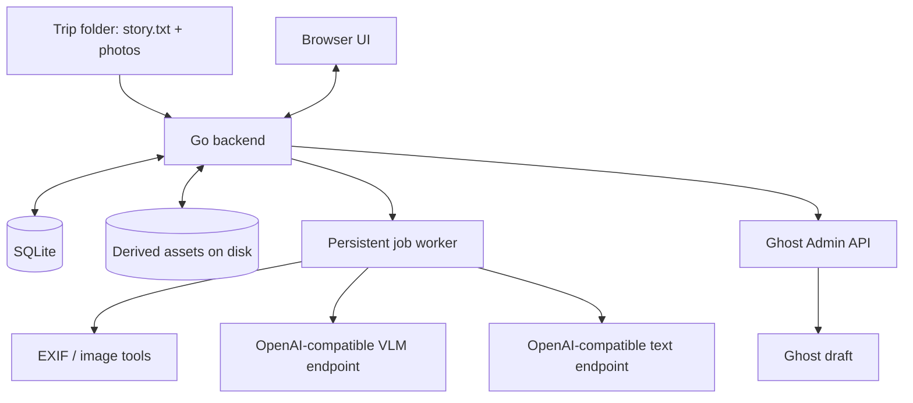

# Travel Diary AI — Implementation Specification v1.0

**Status:** Ready for implementation planning  
**Target agent:** Pi with Superpowers  
**Date:** 2026-11-01  
**Architecture:** Portable, local-first Go modular monolith

## 1. Product goal

Create a self-hosted browser application that turns a directory of user-authored travel notes and photos into a high-quality, illustrated Ghost blog draft. The application analyses images with a configurable local vision-language model (VLM), extracts events and factual statements from notes, recommends a curated photo selection, matches approved photos with relevant parts of the story, and generates a first-person narrative guided by a versioned writing-style profile derived from the author's existing Ghost posts. A human reviews, edits and explicitly approves the article before exporting it as a Ghost **draft**. Never automatically publish.

### Accepted product decisions

- Backend: Go.
- Frontend: browser-based, block-oriented visual article editor.
- Article canonical representation: structured versioned JSON, not Ghost HTML, Markdown, or Lexical.
- Storage: SQLite for metadata and state, filesystem for derived assets.
- Inference: OpenAI-compatible API, initially OMLX hosted on a LAN server. Separate configurable vision and text model IDs; they may point to the same server.
- Photo selection: AI recommendations, followed by mandatory user approval. Suggestions must remain overrideable.
- Publishing: local review followed by user-triggered Ghost draft creation/update only.
- Deployment: cross-platform Go binary plus Dockerfile and Docker Compose; no Apple-specific runtime dependencies.
- Inputs: `story.txt` and photos (JPEG/PNG/HEIC initially); originals remain immutable.

### Non-goals for v1

- Automatic public publication or scheduling.
- Autonomous web research or claims about places beyond supplied evidence.
- Apple Notes syncing; users paste/export content to story.txt.
- RAW camera formats, video or Live Photo motion processing.
- Face recognition, identity inference, emotion inference, or personal profiling of people in photographs.
- Fine-tuning an LLM, internet embeddings/vector databases, or cloud inference.
- Multi-user collaborative editing, external account management, or a mobile app.
- Pixel-perfect reproduction of Ghost's theme inside the local editor.

## 2. User workflow and acceptance boundary

1. User selects a local trip folder or imports an archive (notes plus photos). Show a preview of detected files and validate support.
2. Application creates a trip record, inventories files, hashes input, extracts metadata, creates preview assets and duplicate/similar-image groups.
3. Application performs bounded VLM analysis of photos. AI outputs verified schema; visual facts separated from hypotheses. Job progress is visible.
4. User reviews the **Recommended**, **Review**, and **Not selected** categories, approves a selection, and can override individual choices.
5. Application extracts notes into evidence-backed experience records, uses selected photos to suggest matches, and displays an editable article outline.
6. Application generates narrative blocks, galleries, captions, article title/excerpt/slug/tags and a feature-image suggestion; all are editable. No fabricated anecdotes or subjective opinions.
7. User reviews a local article preview and can edit blocks, reassign photos, reorder galleries, regenerate a selected block, and undo edits.
8. User explicitly clicks **Create/Update Ghost Draft**. Application displays a confirmation summary, uploads approved derived photos and creates/updates an unpublished Ghost draft.
9. User receives the Ghost draft URL and can open it in the Ghost editor. Public publication remains outside the app.

**Gate conditions:** Cannot generate the final story until photo selection is explicitly approved; cannot export until the article has been reviewed and explicitly approved. Edits after approval reset article approval; optionally preserve a specific approved revision for export. Ghost export must use the exact approved revision.

## 3. System boundaries



Backend: one Go process including HTTP server, application services and a configurable number of in-process background workers, backed by durable SQLite job records. A worker may execute in the same binary; startup reclaims interrupted jobs. Docker must not require a separate broker, Redis, or distributed queue.

Recommended frontend: server-rendered Go templates for application shell and lists, HTMX for simple interactions, and a small JS editor component such as Tiptap for rich-text blocks and drag-and-drop gallery editing. A dedicated frontend build stage is acceptable; no Node runtime required in production. Prefer block-based editor integration that preserves canonical JSON semantics over adopting the editor's proprietary JSON as database truth.

## 4. Source import and files

Input example:

```text
Japan-2026/
  story.txt
  DSC0001.JPG
  DSC0002.JPG
  IMG_1034.HEIC
  IMG_1035.PNG
```

Users should be able to import a directory *on the server-side filesystem* (configured safe import roots). Browsers cannot transmit arbitrary client filesystem paths to a remote Docker host. Also provide browser upload (multiple files or zip) for remote hosts, with extraction limits, path traversal prevention and file size limits. Initial milestone may implement server-side directory import first, but the completed product must support a browser upload from a different computer.

Provide a read-only import. Never edit, rename, rotate, overwrite or delete original photos. Create previews/exports under an application-owned data directory.

Use SHA-256 for content identity, compare original filename and bytes; handle reused filenames. Detect exact duplicates with hashes, near duplicates with perceptual hashing, and reserve optional embeddings for ambiguous similarity. Preserve multiple variants if the user explicitly selects them.

ExifTool may be invoked as a configured executable for robust metadata extraction; libvips may be used via CLI or native binding for transformation. Document platform dependencies; make transformations testable behind interfaces. HEIC input support depends on codec availability in the built libvips and must be checked at startup. Apply EXIF orientation and ICC-to-sRGB conversion for derived JPEG/WebP without unintentionally changing the aesthetic grade. Preserve originals untouched. Strip GPS and other sensitive EXIF fields from published derivatives. Do not embed original geolocation in external uploads.

Default image targets: thumbnail 400px long edge, preview 1200px, export 2560px long edge, preserve aspect ratio, no upscale, configurable JPEG quality (~85) or WebP; avoid aggressive sharpening or auto-enhance. Transparent PNG can remain PNG where necessary. Make image types, limits and output encoding configurable.

## 5. AI provider contract

Use a generic OpenAI-compatible HTTP adapter with endpoints configurable per role:

```yaml
ai:
  vision:
    base_url: http://omlx-host:8000/v1
    model: vision-model-id
    timeout_seconds: 180
    concurrency: 1
  writer:
    base_url: http://omlx-host:8000/v1
    model: writing-model-id
    timeout_seconds: 240
    concurrency: 1
  generation:
    temperature: 0.4
    max_output_tokens: 4096
```

Credentials are supplied via environment variables or a secret file, not stored in plaintext logs or exposed to browsers. Support `/v1/models` for discovery, and `/v1/chat/completions` for requests. Model IDs are arbitrary strings. For image requests send a resized preview as an OpenAI-style image content part; prefer a local base64 data URI so a remote URL fetch is unnecessary. The configured VLM may not support every response_format feature; use JSON Schema mode when supported and fall back to strict JSON prompting plus local schema validation. Never assume a text-only quantisation supports image input. A model connection test must validate **actual image understanding**, not just whether `/v1/models` returns a name.

Provide status checks, cancellation, rate/concurrency controls, bounded retry with jitter for transient connection failures, and a visible actionable error for unsupported model features. Cache outputs by `(original SHA256, derivative specification, model ID, prompt version, schema version)` for vision, and by `(notes hash, selected photo IDs, evidence version, style profile version, writer model ID, prompt version)` for generation. Record model ID, prompt version, configuration and output validation for reproducibility. Keep inference inputs limited to locally approved notes/photos. No external APIs unless specifically configured for Ghost.

## 6. Vision and image selection

Pipeline:

1. Metadata: capture timestamp, timezone ambiguity, optional GPS, width, height, orientation, camera/lens, ICC profile.
2. Deterministic checks: supported format, dimensions, basic exposure/sharpness signals, hash/perceptual duplicate group, image aspect ratio.
3. VLM analysis of a constrained preview: visible objects, scene type, signs (as tentative OCR), foods, environment, potential location clues. No identifying people or making personality claims.
4. Combine metadata and visual description with notes for matching. Distinguish observed scene from candidate place name. Never upgrade a location guess into a fact without corroboration.
5. Rank recommendations with explainable factors: content relevance, variety, image quality, duplicates, coverage of experiences. Present reasons, not opaque scores alone.
6. User approves, rejects, or manually selects images. Preserve decisions on reruns; do not auto-overwrite user choices.

Example VLM output (validate against Go structs/JSON Schema):

```json
{
  "schema_version": 1,
  "photo_id": "p_123",
  "observed": {
    "description": "A bowl of ramen with noodles and a halved egg",
    "subjects": ["ramen", "egg", "chopsticks"],
    "category": "food",
    "visible_text": []
  },
  "hypotheses": [
    {"type": "place", "value": "Kyoto", "confidence": 0.35}
  ],
  "quality_flags": [],
  "safety_flags": []
}
```

Confidence values are heuristic, not statistically calibrated probabilities. Prefer user-readable labels with evidence. Photos with no matches go into an Unmatched collection. Show all photos, not only recommendations.

## 7. Evidence, writing style and text generation

**Evidence precedence:** user notes for events/food/personal sentiment; EXIF/GPS for contextual time/location (with clock/GPS uncertainty); VLM for *visible* subjects; optional verified references only in a future opt-in research feature.

Extract experiences as structured items with source spans (character offsets/line numbers in story.txt), chronology (if present), location fields, named foods, user-authored sentiment and uncertain claims. Use the extracted facts as generation constraints. Include a traceability table linking each article claim to notes or verified image metadata/observations. A deterministic evidence verifier should flag claims not supported by an evidence ID; a separate AI audit may add warnings but is not a substitute for evidence traceability.

Import previously published **author-selected** Ghost posts through Content API (or allow pasted Markdown/plaintext), and build a versioned `StyleProfile` with paragraph length, narrative perspective, tone, humour, section organisation, caption conventions and representative writing excerpts. The app must permit editing this profile. Do not treat old posts as factual evidence for new trips. Style profile modifications should create new versions; approval of an AI-generated draft must not implicitly modify the style profile.

Draft generation stages:

- Extract and validate experiences.
- Match approved photos to experiences using semantic + timestamp/GPS signals.
- Propose editable outline.
- Write sections in first-person with supported facts only, with restrained humour when supported by notes.
- Generate captions and alt text from observed image content, avoiding unsupported restaurant/location specifics.
- Generate title, slug candidate, excerpt, suggested tags, feature photo recommendation.
- Run grounding checks and display unresolved issues before the user may approve.

The user can regenerate individual sections, title, excerpt or captions without modifying other blocks. Protect user-edited blocks from automatic rewrites. On explicit regeneration, show the diff and offer accept/reject. Restore previous revisions.

## 8. Canonical document data format

Store `ArticleDocument` as JSON with a required `schema_version`, stable block IDs, order, and strongly typed block variants. Persist every approved or user-edited change as a revision. Avoid directly storing arbitrary untrusted HTML. Example:

```json
{
  "schema_version": 1,
  "article_id": "a_123",
  "title": "Kyoto, Japan",
  "slug": "kyoto-japan",
  "excerpt": "Notes from our trip to Kyoto.",
  "feature_photo_id": "p_003",
  "tags": ["Japan", "Kyoto"],
  "blocks": [
    {"id": "b1", "type": "heading", "level": 2, "text": "Fushimi Inari"},
    {"id": "b2", "type": "paragraph", "text": "We reached the shrine early...", "evidence_ids": ["e1"]},
    {"id": "b3", "type": "gallery", "photo_ids": ["p_011", "p_012"], "caption": "At the shrine"}
  ]
}
```

Implement `heading`, `paragraph`, `image`, `gallery` and optional `quote` block types in v1. Inline bold/italic/link styling may use a limited semantic rich-text AST rather than raw HTML. Provide explicit migrate/validate functions for version changes. Photo IDs must correspond to approved photos; no missing assets allowed in export. Use an HTML sanitiser on any imported user material. Editor state should be represented by canonical domain structs, not coupled to Ghost Lexical internals.

## 9. Persistent state, database and job engine

SQLite schema (initial logical entities):

- `trips`: ID, name, source path/import archive, notes hash, status, created_at, updated_at.
- `source_files`: trip_id, relative path, MIME, bytes, SHA256, capture metadata, scan error.
- `photos`: ID, source_file_id, EXIF JSON, derivative asset IDs, vision result/version, ranking reasons, selection status, user override.
- `photo_groups`: duplicate/similarity cluster and member references.
- `experiences`: ID, trip_id, extracted note spans, evidence attributes, confidence/uncertainty.
- `photo_matches`: experience/photo pair, algorithm version, score/justification, user override.
- `style_profiles` and `style_profile_versions`.
- `articles`: ID, trip_id, current revision, approved revision, status, title.
- `article_revisions`: immutable canonical JSON, author (system/user), reason, timestamp, provenance.
- `jobs`: ID, type, target, state, step, attempt count, lease/heartbeat, error, cancellation flag, idempotency key.
- `ghost_exports`: article/revision ID, remote post ID, remote updated_at, exported asset hashes and URLs, last result/error.

Use SQLite WAL, foreign keys and transactions; make backups possible while running. Apply migrations at startup with version tracking and rollback guidance. Suggested statuses:

`IMPORTED → ANALYSING → PHOTO_REVIEW → PHOTOS_APPROVED → GENERATING → EDITING → ARTICLE_APPROVED → EXPORTED_DRAFT`.

Failures should not erase the last valid state. Model job statuses independently: `queued`, `running`, `succeeded`, `failed`, `cancelled`, `retry_wait`. Jobs must be idempotent or safe to resume. On crash/startup, expired running job leases are reclaimed. Avoid concurrently processing the same photo/trip with duplicate jobs. Provide job cancellation and stage retry. Changes to photos invalidate matches/layout, **not** EXIF/vision caches. Changes to notes invalidate evidence/matches/story, **not** photo analysis. Changes to style profile invalidate story proposals, **not** facts/vision.

## 10. API contract (v1)

All application endpoints under `/api/v1`; JSON requests and responses except uploads. Use proper HTTP status codes, consistent error shape `{ "code", "message", "details" }` and request IDs. Avoid leaking server absolute paths or secrets in errors.

| Method | Endpoint | Purpose |
|---|---|---|
| GET | `/health/live` | Process liveness |
| GET | `/health/ready` | Database/assets readiness |
| GET | `/api/v1/settings/models` | Available model IDs and connectivity |
| POST | `/api/v1/settings/models/test` | Test text/vision inference |
| GET | `/api/v1/trips` | List trips |
| POST | `/api/v1/trips/import-path` | Import allowlisted server directory |
| POST | `/api/v1/trips/import-upload` | Upload files/archive |
| GET | `/api/v1/trips/{id}` | Trip and stage summary |
| POST | `/api/v1/trips/{id}/analyse` | Launch scan/analysis job |
| GET | `/api/v1/trips/{id}/photos` | Images, metadata, recommendations, filters |
| PATCH | `/api/v1/trips/{id}/photos/{photoId}` | Set selection/order override |
| POST | `/api/v1/trips/{id}/photos/approve` | Approve current selection snapshot |
| GET | `/api/v1/trips/{id}/experiences` | Evidence/extracted event list |
| POST | `/api/v1/trips/{id}/outline` | Create or update outline |
| POST | `/api/v1/trips/{id}/generate` | Queue story generation |
| GET | `/api/v1/articles/{id}` | Canonical article + ETag/revision |
| PUT | `/api/v1/articles/{id}` | Save edited document with revision precondition |
| POST | `/api/v1/articles/{id}/blocks/{blockId}/regenerate` | Proposed replacement only |
| GET | `/api/v1/articles/{id}/revisions` | History |
| POST | `/api/v1/articles/{id}/approve` | Approve exact revision |
| POST | `/api/v1/articles/{id}/ghost-draft` | Create/update Ghost draft from approved revision |
| GET | `/api/v1/jobs/{id}` | Job status/progress |
| POST | `/api/v1/jobs/{id}/cancel` | Request cancellation |
| GET | `/api/v1/style-profiles` | Style profiles |
| POST | `/api/v1/style-profiles/import-ghost` | Import selected Ghost samples |
| PUT | `/api/v1/style-profiles/{id}` | Update/version style profile |

Use polling or server-sent events to update progress; UI must work without WebSockets. All write requests require authenticated session and CSRF protection (or equivalent same-origin controls); add optimistic concurrency via article revision/version to prevent silent overwrites.

## 11. Ghost exporter

Configuration: Ghost Admin URL, Admin API integration key, API version negotiation and connection test. Store key outside DB where practical (environment variable or mounted secret file). Generate short-lived HS256 JWT on backend as documented by Ghost; do not expose Admin key/token to browser. Use HTTPS for remote Ghost. Local HTTP only when explicitly configured for trusted local deployment.

Photo export sequence:

1. Freeze approved article revision.
2. Confirm referenced photo IDs resolve to prepared export derivatives, no unapproved/unknown photos, and captions/alt text validated.
3. Upload missing images via `POST /ghost/api/admin/images/upload/` and persist returned remote URLs per asset hash. Note: repeated uploads can produce orphans in Ghost; reuse known uploads and do not promise server-side image idempotency.
4. Convert the canonical document into Ghost-supported format. Start with HTML source import for headings, paragraphs and images. Build a small integration spike for **native editable galleries** and evaluate Lexical generation if required. Provide graceful fallback to individual image cards with captions if native gallery conversion cannot be verified.
5. Create post using Admin API with status `draft`, or update previously mapped draft. Persist remote post ID atomically after a successful response.
6. For updates read remote post first, compare `updated_at` and remote status; refuse to overwrite if the remote post was edited, published or conflicts with the last known revision without user acknowledgement. The implementation must not accidentally unpublish a live post.
7. Return Ghost draft admin URL and a structured export report. If network response is ambiguous, reconcile by known remote mapping and other safe identifiers before retrying a creation to avoid duplicate drafts.

Never expose a publish action in v1. Do not change `status` to published. When user locally changes the article after export, offer a deliberate **Update Ghost Draft** action and show the latest local revision vs remote conflict information.

## 12. Security and privacy

- Bind to loopback by default; require explicit configuration to expose on LAN.
- For LAN deployment, require login with single-user password/session (secure cookie), CSRF protection and configurable TLS/reverse-proxy guidance. Do not assume a private LAN is inherently trusted.
- Import path allowlist, prevent traversal and symlink escape; never permit arbitrary server file reading through HTTP paths.
- Validate MIME from file content and extensions, limit upload size/count, archive expansion size and path names. Reject zip bombs.
- Treat notes, image text, and historical posts as **untrusted content**; model responses cannot issue tool commands or modify system instructions. All LLM outputs are data validated against schema.
- Backend calls only configured, allowlisted OMLX and Ghost endpoints; guard against arbitrary URL SSRF and redirect-to-private-network surprises when remote URL input is ever supported.
- No telemetry, third-party analytics, or unconfigured internet calls.
- Remove GPS and sensitive EXIF from published derivatives; never upload originals.
- Encrypt transport when crossing untrusted network boundaries; keep backups and logs free of tokens and sensitive photo content.
- Use process user with least privilege; read-only source directory mounts and writable app-data volume.
- Audit critical user decisions: photo approval, article approval, Ghost export.

## 13. Deployment and configuration

Provide:

- Multi-stage `Dockerfile` (Go build, frontend build if needed, runtime image with necessary image codecs/tools).
- `compose.yaml` mounting persistent `/data` and optional read-only `/imports`; documented networking to LAN OMLX/Ghost endpoints. Do not use localhost inside container when pointing at a service on host or LAN.
- Native build/install instructions for macOS and Linux, including ExifTool/libvips dependencies.
- `.env.example`, sample YAML configuration and secret handling guidance.
- Health checks and a reproducible first-run onboarding page.
- Support x86_64 and arm64 images where dependencies allow.

Example:

```yaml
services:
  travel-diary:
    build: .
    ports:
      - "127.0.0.1:8080:8080"
    volumes:
      - ./data:/data
      - ./trips:/imports:ro
    env_file: .env
    restart: unless-stopped
```

Local-only bind is the secure default; users may explicitly configure a reverse proxy for LAN access. Document Docker host vs LAN service resolution. Do not bundle OMLX or Ghost in this Compose stack; they are external runtime services.

## 14. Testing requirements

- Go unit tests for file inventory, hashes, EXIF parser adapter, image transformations, state transitions, cache keys, article schema validation, evidence links, slug generation, Ghost JWT and error handling.
- Golden-file tests for canonical JSON → HTML/Ghost mapping including image/gallery/alt text and special characters.
- Fake OpenAI-compatible server for text/vision tests: malformed JSON, timeouts, vision unsupported, 429/5xx, partial response, cancellation and schema evolution.
- Fake Ghost Admin API: successful uploads, conflicting edits, failed/partial uploads, duplicate retry handling, published remote post refusal.
- Integration test with temporary SQLite DB and fixture images validating resume after simulated crash and safe invalidation when notes/photo selection changes.
- Browser end-to-end tests for import → analysis → approval → generate → edit → approve → Ghost draft (mock services).
- Security tests: traversal, symlink escapes, malicious image metadata, oversized zip archives, CSRF, auth, XSS, prompt injection in notes, external URL restrictions.
- Manual on-host validation with at least 20 varied real travel photos and two historical writing samples; inspect for invented facts, location hallucinations, bad cropping, duplicated photos and Ghost layout compatibility.

### Release acceptance criteria

A. Import directory with at least 100 mixed JPEG/PNG/HEIC photos without changing originals.

B. For 20 representative images, create stable schema-valid visual analyses; report unsupported VLM configuration clearly and preserve completed work.

C. User can approve recommended photos and override any recommendation; re-running analysis never removes an explicit override.

D. Given 8–15 bullet-point travel notes, generator creates a sectioned article with traceable claims, matching photos and editable galleries. Unsupported assertions are highlighted and must be resolved before approval.

E. Block edits are saved as recoverable revisions; regenerating one block cannot modify another block.

F. Restart mid-job and resume safely; unchanged photos are not re-analysed when notes change.

G. Ghost export creates an unpublished draft with working images and no original GPS metadata. Re-export updates mapped draft, does not duplicate it, and respects remote edit conflicts.

H. Same service can run in Docker on arm64 or amd64 host without macOS-only dependencies, and connect over LAN to OMLX.

I. No credentials in browser payloads, application logs, or generated artifacts.

## 15. Implementation roadmap for Pi with Superpowers

**Milestone 0 — Architecture probes**
- Confirm intended OMLX server actual vision support with a fixture image; test strict JSON mode and fallback.
- Confirm supported HEIC conversion in intended Docker image.
- Against a local/staging Ghost, test single-image upload, HTML source import, edit of a draft, and native gallery round-trip. Record Ghost version and observed limitations.
- Deliver ADRs (architecture decision records) for editor framework, photo processing library and Ghost gallery representation.

**Milestone 1 — Vertical slice**
- Bootstrap Go application, SQLite migrations, minimal web pages and one worker.
- Server-side import for a trip with story.txt and five images, hashes/metadata, previews and cache.
- Connect to VLM + writer with separate model settings; analyse five images; create a single prose section and image matches; persist canonical document.
- Tests and documented demo command. NO Ghost integration yet.

**Milestone 2 — Photo ingestion/curation**
- Build robust scan/format handling, duplicate clustering, ranking and review grid.
- User override and approval gate, with cached stages and progress/retry UI.
- Browser multi-file/zip upload; complete security hardening.

**Milestone 3 — Evidence and style-aware writing**
- Notes parser and evidence extraction, photo matching, style-profile Ghost import/versioning.
- Outline and section drafting, grounding audit and claim traceability.
- Regenerate selected block without overwriting user edits.

**Milestone 4 — Visual editor and revisions**
- Block editor with headings/paragraphs/images/galleries, drag-and-drop order and caption/alt editing.
- Revision history, approval workflow, local preview, conflict-safe updates.

**Milestone 5 — Ghost integration**
- JWT authentication, image upload/cache, draft create/update, remote conflict detection, status guard.
- Test gallery import and acceptable fallback with real Ghost installation.
- Confirmation UI and export report.

**Milestone 6 — Portability and polish**
- Multi-architecture Docker image, native instructions, onboarding, observability, backup/restore, end-to-end tests, documentation and fixture demo.

### Pi execution rules

- Use a test-first or test-backed small iteration workflow; each milestone must end with green relevant tests and an observable demo.
- Before introducing an external library or platform-specific command, validate that it is actively maintained and works in Linux Docker/arm64.
- Prefer standard Go and simple modules. Avoid microservices, vector databases or remote AI frameworks until evidence justifies them.
- Stop at documented milestone boundaries for human acceptance, especially photo ranking and Ghost export fidelity.
- Keep prompts versioned under `prompts/` and schemas under `schemas/`; include representative golden fixtures.
- Maintain `docs/architecture.md`, `docs/decisions/`, `docs/deployment.md`, `docs/testing.md`, and `docs/known-limitations.md`.

## 16. Open technical validation (not product blockers)

1. **Actual VLM checkpoint:** determine which checkpoint in user's OMLX installation supports image analysis and structured outputs. Keep model IDs configurable.
2. **Ghost version and theme:** verify Lexical gallery compatibility and visual result on user's installation. Implement a safe single-image fallback if necessary.
3. **Import topology:** if users import via browser from a laptop instead of a server filesystem, use upload/zip workflow; server path import remains useful for mounted NAS/shared directories.
4. **HEIC codec availability:** check chosen Docker base image; fail gracefully when unsupported.
5. **Scale/performance:** benchmark 20–100 photos on current OMLX setup, adjust concurrency and preview sizing; never hard-code latency guarantees.

These are implementation probes, not reasons to delay building the vertical slice.

## 17. References

- Ghost Admin API images: https://docs.ghost.org/admin-api/images/overview
- Ghost developer documentation and Admin API: https://docs.ghost.org/admin-api/
- Ghost Content API: https://ghost.org/docs/content-api/
- Ghost editor cards: https://ghost.org/help/cards/
- OMLX reference: https://github.com/jundot/omlx

---

**Definition of done:** A user can import notes and photographs, review and approve an AI-recommended photo set, generate and edit a grounded article in a local block editor, and deliberately create or update a Ghost **draft** without ever having to publish publicly or send source photographs to a cloud inference service.
